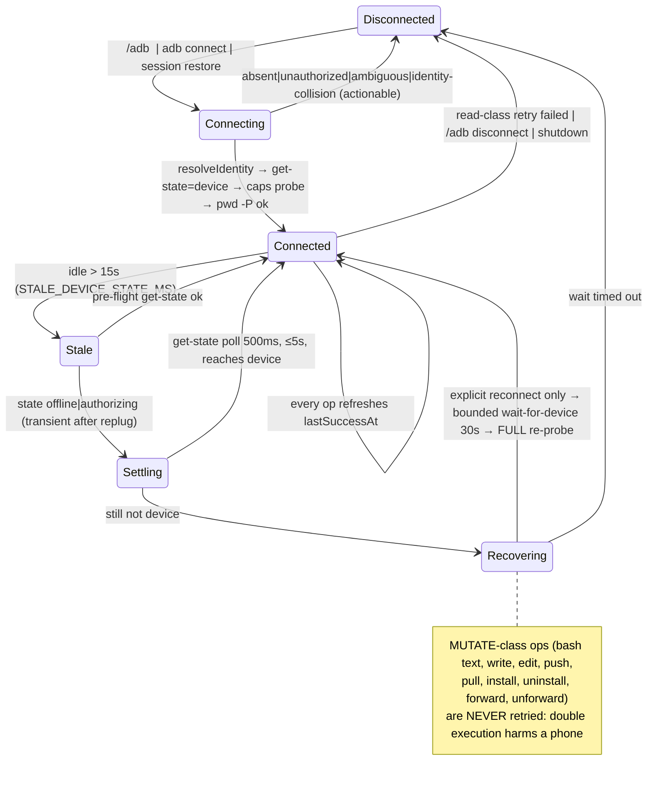

# ARCHITECTURE PLAN — pi-adb-remote: Android device workspace transport

Status: **Final (v3)** — post-interview (12 decisions), post-red-team (30 findings triaged: 25 folded, 2 rejected, 3 resolved by follow-up interview). Every fact marked [VERIFIED] was measured on a live device during planning; nothing here is a guess unless labelled [HYPOTHESIS].

## 1. Summary

`pi-ssh-remote` routes Pi's `read`/`write`/`edit`/`bash` tools to a remote host through one long-lived `ssh2` client (exec channels, SFTP, forwarded channels). This plan converts it into `pi-adb-remote`, where the workspace is **an Android device reached through the `adb` CLI**, and the PC shell and the device shell are never both live: while a device is selected, all four tools execute **on the device**, and the PC is reachable only through explicitly named bridge actions.

The work is a transport swap plus a subtraction. **Subtraction:** adb has no authentication, no host keys, no jump hosts — so `src/ssh/auth.ts`, `src/ssh/config.ts`, `src/ssh/connection.ts`, known-hosts storage, the host-key trust prompt, password/passphrase caches, the `forget` action, and the ssh2 reconnect machinery all disappear. **Swap:** each operation becomes a short-lived `adb` subprocess (measured ~20 ms/call, parallel-safe), which gives a *better* error surface than the current SSH exec channel (real exit codes, separated stderr, byte-exact `exec-out`/`pull`/`push`) but leaves **no long-lived object to notice a disconnect** — liveness becomes an explicitly probed state, and device *identity* becomes a resolution problem (§4.3) rather than a string.

Three findings shape everything. (1) The current timeout wrapper `timeout --signal=TERM --kill-after=5s N bash -lc …` (`index.ts:186-189`) **cannot work on a device**: there is no `bash`, and toybox `timeout` rejects those long options (rc=125). (2) There is no SFTP, so file access is re-derived per operation from `stat`/`sed`/`head -c`/`exec-out`/`push`/`pull`, and the text-vs-binary gate that relies on `file --mime-type` (`index.ts:1284-1291`) must move host-side — that flag does not exist on device. (3) `adb -s` does **not** accept `ro.serialno` for an mDNS/TLS transport (`adb: device '05WAY1YE00' not found` while `ro.serialno=05WAY1YE00`), so a persisted transport serial silently rots the moment the phone changes network.

**Deferred out of this release deliberately** (each with its reason, not an omission): `privilege:"su"`/root escalation, `adb root`/`unroot`/`reboot`/`kill-server`, `adb reverse`, device-backed `grep`/`find`/`ls` implementations, and a persistent adb-server socket transport.

## 2. Verified device ground truth

Measured on: **Pixel 3a (`sargo`), Android 12 / API 32, `ro.build.type=user`, `ro.debuggable=0`, `ro.secure=1`, `su` absent**, platform-tools **35.0.2** (`adb 1.0.41`), transport serial `adb-05WAY1YE00-E1sWj7._adb-tls-connect._tcp` (mDNS TLS), `ro.serialno`=`ro.boot.serialno`=`05WAY1YE00`. Treat this table as the specification.

| # | Probe | Result | Consequence |
|---|---|---|---|
| V1 | `shell 'exit 42'` / `'false'` / `'nosuchcmd'` | rc 42 / 1 / 127 | `shell` is the exec transport; exit codes authoritative |
| V2 | `shell 'echo o; echo e 1>&2'` | stdout/stderr separate | error extraction works (shell proto v2) |
| V3 | `exec-out false` | **rc 0 always** | `exec-out` is byte-only; never a success test |
| V4 | `exec-out cat`, `pull` of 256 B random | byte-exact | binary read path |
| V5 | `shell cat` same file | byte-exact *here* only (raw mode, no pty) | do not rely on it for bytes |
| V6 | `push`/`pull` failure | rc=1, `adb: error: …` on stderr | write path + error extraction |
| V7 | `bash -lc` | `/system/bin/sh: bash: inaccessible or not found` | **no bash**; POSIX sh (mksh) only |
| V8 | `timeout --signal=TERM --kill-after=5s 1 sleep 3` | `timeout: Unknown option 'kill-after=5s'`, rc **125** | `withRemoteTimeout` (`index.ts:186`) must die |
| V9 | `timeout -k 5 -s TERM 1 sleep 3` | rc 124 | the portable device-side form |
| V10 | `file --mime-type -b` | `file: Unknown option 'mime-type'`, rc 1 | replace `detectRemoteMimeType` (`index.ts:1284`) |
| V11 | `file -b` on PNG | `data` (no MIME; wording ROM-specific) | host-side magic sniffing |
| V12 | applets `timeout sed awk stat find grep head tail wc cp mv rm mkdir chmod ls readlink du` | all present | `sed -n 'a,bp'`, `stat -c`, `grep -R -n -E -o -c`, `find -maxdepth -name -type -mmin -delete`, `readlink -f` |
| V13 | `stat -c '%F|%a|%s'` | `regular file\|666\|1`, `regular empty file\|666\|0`, `symbolic link\|777\|30` | exact `%F` vocabulary; `%a` is clean octal |
| V14 | `stat -L -c … <symlink>` | `regular file\|666\|1` (target), rc 0; missing path → nothing on stdout, `‖ echo ABSENT` branch fires | resolve-symlink stat in ONE spawn |
| V15 | `HOME`/fresh `pwd` | `HOME=/`, cwd `/` | default cwd must not be `~` |
| V16 | `/data/local/tmp`: `mkdir -p`, `echo >`, `push`, `mv`, `chmod`, `rm -rf` | all succeed (`drwxrwx--x shell shell`) | **default device cwd** |
| V17 | `touch /system/pi-test` | `Read-only file system`, rc 1 | surface device errors verbatim |
| V18 | latency ~20 ms; 3 parallel spawns | no interference | process-per-call adequate; no pool |
| V19 | `kill -9` local adb mid `sleep 42` (`shell -T`) | **no orphan on device** | abort safe for `shell`; **not proven for `exec-out`** → V26 |
| V20 | argv 4 KB→60 KB delivered; 200 KB fails **host-side** (`Argument list too long`) | device side has no small limit | guard is a *host* concern (F24) |
| V21 | `shell -n -T -e none 'exit 7'` | rc 7 | flag set for every exec is safe |
| V22 | `shell -T "sed -n '1,3p' f"` vs `exec-out` vs original file | **all three md5-identical** (embedded CRLF preserved) | text ranges keep using `shell` (real exit code) |
| V23 | `exec-out "timeout -k 2 -s TERM 3 sh -c 'logcat'"` | stopped at 3.07 s, 4 615 956 B captured | device-side timeout must wrap `exec-out` too |
| V24 | `adb forward --no-rebind tcp:X` while a **foreign** listener owns X | `adb: error: cannot bind listener: Address already in use`, rc 1 | distinguishable collision class |
| V25 | `adb forward --no-rebind tcp:X` over **an existing adb forward** | `adb: error: cannot rebind existing socket`, rc 1 | our-replace path is distinguishable |
| V26 | `adb devices -l` / `get-state` / `wait-for-device` / `ANDROID_SERIAL` / `start-server` (idempotent, rc 0) | all work; `-l` gives `product: model: device: transport_id:` | discovery, liveness, recovery |
| V27 | `adb -s BOGUS shell` | `adb: device 'BOGUS' not found`, rc 1 | `absent` classification |
| V28 | `adb -s 05WAY1YE00 shell` (i.e. `ro.serialno` of a connected mDNS device) | **`adb: device '05WAY1YE00' not found`**; prefix matching also unsupported | identity ≠ selector ⇒ resolution layer (§4.3) |
| V29 | device has **no** `adb` binary | `adb: inaccessible or not found` | host-only ops must be tool actions (§5.6) |
| V30 | device has `logcat screencap input pm am settings dumpsys svc wm uiautomator monkey screenrecord` | present | recipes, not actions |
| V31 | `exec-out screencap -p` | valid PNG, 526 389 B | 8 MiB image cap is safe |
| V32 | `dumpsys window \| grep -E 'mDreamingLockscreen\|isKeyguardShowing'` | `mShowingDream=false mDreamingLockscreen=false`, `isKeyguardShowing=false` | best-effort lock-screen note for `screen` |
| V33 | `find <dir> -type f -mmin +5 -delete` | deleted an aged file, rc 0, left the rest | staging garbage collection |
| V34 | `push` of a zero-byte file, then `exec-out head -c` | 0 bytes; `stat` says `regular empty file\|666\|0` | "empty ⇒ error" must be gated on `size > 0` |
| V35 | `ro.build.type=user`, `ro.debuggable=0`, `ro.secure=1`, `su` absent | confirmed | root path untestable here ⇒ deferred (D9) |

[HYPOTHESIS — deliberately not provoked]: adb client banner text `* daemon not running; starting now at tcp:5037` and `adb server version (…) doesn't match this client (…); killing...`. Provoking them means `adb kill-server`, which would drop every other tool's device session. Handling is specified defensively in F18; the classifier asserts on the canonical strings only in fixtures.

## 3. System boundaries

```mermaid
flowchart LR
  subgraph HOST["Pi process (Node, this package)"]
    IDX["index.ts<br/>tool routing, state machine, limits, UI"]
    subgraph ADB["src/adb/"]
      TGT["target.ts — endpoint grammar, stable identity, args"]
      CLI["cli.ts — binary resolution + spawn engine"]
      DEV["device.ts — discovery, identity resolution, capabilities, classifier"]
      TR["transport.ts — AdbTransport: exec stat read write forward install"]
      MIME["mime.ts — magic + extension + looksLikeText"]
      OUT["exec-output.ts — bounded accumulator + host spill"]
    end
    TOOLS["routed: read write bash edit<br/>control: adb<br/>guidance-gated: ls grep find"]
    CFG[("$AGENT_DIR/adb-remote-config.json<br/>adb-remote-memories/*.json")]
    SESS[("session entries: pi-adb-remote-state v2")]
  end
  subgraph AS[("adb server :5037 — owned by platform-tools, not by us")]
    FWDT["forward table (survives our exit)"]
  end
  subgraph PHONE["Android device (uid=2000 shell, SELinux u:r:shell:s0)"]
    MKSH["/system/bin/sh (mksh) + toybox"]
    FS["/data/local/tmp writable · /sdcard noexec FUSE · /system read-only"]
  end
  TOOLS --> IDX --> TR --> CLI -->|"argv array, no host shell"| AS --> MKSH --> FS
  TR -.->|"adb forward / install / pull / push"| FWDT
  TR <-->|"pull/push bytes, spill files"| TMP[("$TMPDIR/pi-adb-remote-*")]
  IDX <--> CFG
  IDX <--> SESS
  TR -->|image bytes| MIME
```

**Non-goals:** no SSH in this package (one package, one transport); no persistent adb-server socket (D1); no `adb root`/`unroot`/`reboot`/`kill-server`; no `adb reverse`; no root/`su` escalation in this release; no device-side daemon; no host↔device project sync.

`AdbTransport` never writes device state the model did not ask for, with three named exceptions: `mkdir -p` of a parent directory for a file the model asked to write, `.pi-staging/` scratch inside that same parent (cleaned in `finally`, GC'd on later writes), and `adb forward` table entries the model asked for. Host-side, it writes only under its per-session `$TMPDIR` directory, which it removes on `session_shutdown`.

## 4. Data flow and state

### 4.1 One routed `bash` call, end to end

```mermaid
sequenceDiagram
  participant M as Model
  participant B as bash tool (index.ts deviceBashOps)
  participant E as ensureDevice()
  participant T as AdbTransport.exec  [MUTATE class]
  participant C as runAdb (cli.ts)
  participant A as adb server :5037
  participant S as mksh on device
  M->>B: bash({command:"ls -la", timeout:30})
  B->>B: snapshot cwd = device.cwd (ignore host cwd arg — F26)
  B->>E: routing active? lastSuccessAt fresh? else getState pre-flight
  E-->>B: DeviceState (or reconnect / fail fast, F6)
  B->>T: exec("ls -la", cwd, {timeoutSeconds, signal})
  T->>T: buildDeviceCommand →<br/>cd -- '/data/local/tmp' && timeout -k 5 -s TERM 30 sh -c 'ls -la'
  T->>C: spawn(adb, ["-s",transportSerial,"shell","-T","-e","none","-n",cmd])
  C->>A: argv, shell:false, no host quoting
  A->>S: sh -c …
  S-->>A: stdout / stderr / exit 0
  A-->>C: chunks → onStdout → DeviceExecAccumulator (hard cap F24)
  C-->>T: {exitCode, stdout, stderr, timedOut, capHit}
  T-->>B: {exitCode}; 127+"not found" ⇒ append on-device hint (F14)
  B->>B: limitDeviceToolResult (per-call + per-turn budgets)
  B-->>M: ≤200 lines / 8 KB + spill path
```

### 4.2 Connection state machine

Under SSH, "connected" was a socket; here it is a **belief**, refreshed by probing.



### 4.3 Identity: two names, and only one is stable

`adb` knows a device by a **transport serial** that is not stable (`adb-<serialno>-<suffix>._adb-tls-connect._tcp` for mDNS/TLS, `host:port` for TCP, `emulator-<n>` for emulators) and **rejects `ro.serialno` as a selector** (V28). So:

| Concept | Value | Lifetime | Where stored |
|---|---|---|---|
| `identity` | `ro.serialno`, else `ro.boot.serialno`, else `transport:<transportId>` | stable across network/replug | config key + session entries |
| `transportSerial` | what `adb devices -l` currently prints | volatile | in-memory only, plus `lastTransportSerial` as a **hint** |

```
resolveIdentity(sessionGlobals, identity): Promise<{ transportSerial, entry: DeviceEntry } | "absent" | "collision">
  1. listDevices(); keep entries with state === "device"
  2. if one entry and its serial matches the hint → verify identity once (getprop ro.serialno) and return it
  3. else probe each candidate's ro.serialno and match against `identity`
  4. exactly one match → return; several devices with that identity → "collision"; none → "absent"
```

Consequences, all testable: an endpoint survives Wi-Fi changes and replugs because it is keyed on `identity`; `adb: device '<hint>' not found` (V27) triggers **re-resolution, not "device gone"**; we never auto-switch to a *different* identity — zero or multiple matches is a hard, named error. Because `adb -s` needs the transport serial, **every** argv build (§5.3) receives the resolved `transportSerial`, never the identity.

### 4.4 cwd is server-owned, snapshotted per call

There is no per-connection cwd on the device (each `adb shell` starts at `/`), so cwd is our state. Rule: `deviceBashOps.exec` **ignores** the `cwd` argument Pi hands it when that argument is the host project dir or is not an absolute device path, and snapshots `device.cwd` once at call entry (F26). `changeRemoteCwd` is single-flight and refuses (or drains, per F27) while a mutating call is in flight, so a `/adb chdir` can never repoint a command that already started.

### 4.5 Persisted state

| Store | Path / key | Written by | Restores after |
|---|---|---|---|
| Endpoint config | `$AGENT_DIR/adb-remote-config.json` (was `ssh-remote-config.json`, `index.ts:116`) | `saveEndpointConfig` (`index.ts:515`) | process restart |
| Runtime cache | `globalThis.__piAdbRemoteRuntimeV1 = { resume?: { identity, cwd, routeDeviceTools, forwards } }` — Maps for passwords/passphrases **deleted** (`index.ts:131-136`) | `disconnect`, `session_shutdown` (`index.ts:1814-1831`) | `/reload`, `new`, `fork` |
| Session entries | `pi.appendEntry("pi-adb-remote-state", { version: 2, … })` (`index.ts:915`) | `persistSessionRemoteState` (`index.ts:913`) | resume/fork (`index.ts:918`) |
| Host scratch | one `$TMPDIR/pi-adb-remote-*` dir per session | `createOutputFile`, spill, `screen`, staging | removed at `session_shutdown` |

## 5. Implementation blueprint

### 5.1 File map

| File | Action | Contents | Depends | Acceptance ("done when") |
|---|---|---|---|---|
| `src/adb/target.ts` | create | `ParsedDevice`, `parseAdbCommand`, `endpointKey`, `deviceArgs`, `canonicalCommand`, `parseWirelessTarget` | 1 | `tests/adb-target.test.ts`: the 8 grammar forms of §5.2 parse correctly; unsupported flags throw naming the supported set; `parse(canonical(p))` deep-equals `p` |
| `src/adb/cli.ts` | create | `resolveAdbBinary`, `shellArgv`, `execOutArgv`, `subcommandArgv`, `runAdb`, `AdbProcessResult`, `CommandTooLongError`, `AdbNotInstalledError` | 1 | `tests/adb-cli.test.ts`: candidate order `$ADB`→SDK→`PATH`; win32 `.exe`; **never** `shell:true`; mandatory `maxCaptureBytes` enforced (child killed, `capHit`); timeout kills child ⇒ `timedOut` |
| `src/adb/device.ts` | create | `parseDevicesOutput`, `listDevices`, `getState`, `resolveIdentity`, `readIdentityProps`, `probeCapabilities`, `DeviceCapabilities`, `classifyAdbError`, `recoveryHint`, `waitForDevice`, `ensureServer` | 2 | `tests/adb-device.test.ts`: the captured real `adb devices -l` line parses to `transport_id:94`; classifier maps V24/V25/V27 + fixture strings to the right `AdbFailure`; identity resolver unit-tested against a stub `listDevices` |
| `src/adb/transport.ts` | create | `AdbTransport`, `DeviceStat`, `DeviceForwardSpec`, `parseForwardSpec`, `buildDeviceCommand`, `withDeviceTimeout`, `METHOD_CLASS`, `InstallFailure` | 2,3,5 | `tests/adb-transport-command.test.ts`: golden device-command strings per §5.4 (incl. cwd containing `'`, `$`, backtick); `METHOD_CLASS` covers every public method exactly once (reflected test); `grep -n "bash -lc\|su 0" src/adb/*.ts` empty |
| `src/adb/mime.ts` | create | `sniffFileKind`, `extensionMime`, `looksLikeText`, `IMAGE_MIME_TYPES`, magic table (4 image magics) | 1 | `tests/adb-mime.test.ts`: PNG/JPEG/GIF/WebP → image MIME; UTF-8 text → text; NUL / invalid UTF-8 → binary; unknown ext + text → text via `looksLikeText` |
| `src/adb/exec-output.ts` | create (moved) | `DeviceExecAccumulator` (from `index.ts:558-638`), `createOutputFile`, `saveOutput`, `previewDeviceOutput` (`index.ts:640-642`); spill prefix `pi-adb-remote-` | 1 | accumulator test: 10 000-line stream ⇒ tail-only model text + readable spill; 2 GB stream ⇒ child killed at `spillCapBytes`, `capHit:true` |
| `src/shell.ts` | modify | keep `shellWords`/`quote` bodies; error text `… in SSH command` → `… in adb command` | 1 | `quote` unchanged (mksh-safe, V12); no `ssh` word in `src/` (`grep -inw ssh src/**` empty) |
| `src/ssh/{auth,config,connection}.ts` | **delete** | — | 6 | `git rm`; `grep -rn "src/ssh\|ssh2\|sftp" .` empty |
| `index.ts` | modify (heavy) | §5.7 conversion map | 6,7 | `npx tsc -p tsconfig.json` 0; `tests/extension-surface.test.ts` green; `grep -inw "ssh\|sftp" index.ts` empty |
| `tests/*` | create | 5 unit files, `tests/extension-surface.test.ts`, `tests/fixtures/fake-adb.sh`, `tests/live/*.live.test.ts` | each unit | `npm test` green **without a device** (fake-adb covers integration); `npm run test:live` green with `PI_ADB_LIVE=1` |
| `tsconfig.json` | create | `{compilerOptions:{strict,noEmit,target:"es2022",module:"nodenext",moduleResolution:"nodenext",allowImportingTsExtensions,skipLibCheck,types:["node"]},include:["index.ts","src","tests"]}` | 1 | `npx tsc -p tsconfig.json` exits 0 |
| `package.json` | modify | name `pi-adb-remote`, `version: 0.1.0`, new `description`/`keywords`, **`dependencies` removed** (`ssh2`, `ssh-config`), `peerDependencies` stay `"*"`, `devDependencies` (pi packages, `typebox`, `@types/node`), `scripts:{test,typecheck,test:live}` | 8 | `npm ls ssh2 ssh-config` empty; `npm run typecheck && npm test` exit 0 |
| `package-lock.json` | modify | regenerate | 9 | lock `name` = `pi-adb-remote`; no ssh2/ssh-config |
| `CHANGELOG.md` | modify | reset: empty `[Unreleased]` + `## [0.1.0] - YYYY-MM-DD` `Added:` entries incl. an explicit *forked from pi-ssh-remote 0.1.15* line; comparison links retargeted | 10 | no SSH-era `## [0.x.y]` entries; `Added`/`Changed`/`Fixed` present |
| `README.md`, `README.zh-CN.md` | modify | adb docs; both release tables show one `0.1.0` row → changelog anchor; ZH fully rewritten and semantically aligned | 10 | every documented command exists in `index.ts` (script check step 10) |
| `AGENTS.md` | modify | versioning section amended **in the same commit as the conversion**: `pi-adb-remote` is a new npm artifact whose release line starts at `0.1.0` as a fork of `pi-ssh-remote 0.1.15`, and its changelog therefore begins there; release-file names updated (`adb-remote-config.json`) | 10 | changelog reset no longer contradicts the governance doc |

### 5.2 `src/adb/target.ts`

Replaces `parseSshCommand` (`src/ssh/config.ts:126-164`) and `cacheId` (`src/ssh/config.ts:165-167`).

```ts
export interface ParsedDevice {
  selector:                                   // how to reach it *right now*
    | { kind: "identity"; identity: string }  // resolved → transport serial (§4.3)
    | { kind: "pick"; pick: "usb" | "tcp" }    // -d | -e, resolved at connect to an identity
    | { kind: "transportId"; transportId: string };
  serverHost?: string;                        // -H
  serverPort?: number;                        // -P  (default 5037 when serverHost set)
  wirelessTarget?: { host: string; port: number };  // `adb connect host[:port]`, default port 5555
  command: string;                            // canonical CONFIG KEY (see canonicalCommand)
  label: string;                              // filled at connect: "Pixel_3a (sargo) · 05WAY1YE00"
}
export function parseAdbCommand(input: string): ParsedDevice;   // strict; message names the supported grammar
export function endpointKey(device: ParsedDevice): string;      // === device.command
export function deviceArgs(device: ParsedDevice, transportSerial?: string): string[];
//   → ["-H",h,"-P",p] ++ (transportSerial ? ["-s",transportSerial] : pick/transport-id form)
export function canonicalCommand(o: { serverHost?; serverPort?; identity?; pick?; transportId? }): string;
//   "adb -i 05WAY1YE00"   (identity form — the persisted key after connect)
//   "adb" | "adb -d" | "adb -e" | "adb -t 94" | "adb -H host -P 5037 -i 05WAY1YE00" | "adb connect h[:p]"
export function parseWirelessTarget(value: string): { host: string; port: number };
```

Accepted forms: `adb`/`adb shell` (sole device → resolved to identity), bare `<serial-or-host:port>`, `adb -s <serial> [shell]`, `adb -t <transport_id>`, `adb -d`, `adb -e`, `adb -H <host> -P <port> [-s <serial>]`, `adb connect <host>[:port]`, and `adb pair <host>[:port]` (one-shot helper, **not** an endpoint). Rejected with an explicit list: any other flag, two positionals, `-P` without `-H`, `pair`/`connect` used as an endpoint, ports outside 1-65535. `adb -i` is *ours* (identity), not adb's — document it in the help text because adb itself uses `-i` for something else, and reject `-i` for anything that is not a `ro.serialno`-shaped token.

### 5.3 `src/adb/cli.ts` and `src/adb/device.ts`

```ts
// cli.ts
export interface AdbBinary { path: string; source: "env" | "sdk" | "path" }
export function resolveAdbBinary(env?: NodeJS.ProcessEnv, platform?: NodeJS.Platform): AdbBinary;
//   $ADB > $ANDROID_HOME|ANDROID_SDK_ROOT/platform-tools/adb(.exe) > ~/Library/Android/sdk (darwin)
//   > %LOCALAPPDATA%\Android\Sdk (win32) > PATH; throws AdbNotInstalledError listing every candidate

export function shellArgv(device, transportSerial, command, o: { stdin: boolean }): string[];
//   [...deviceArgs, "shell", "-T", "-e", "none", ...(o.stdin ? [] : ["-n"]), command]     (V21)
export function execOutArgv(device, transportSerial, command): string[];                 // [..., "exec-out", command]
export interface AdbProcessResult { exitCode: number | null; stdout: Buffer; stderr: Buffer
                                    timedOut: boolean; capHit: boolean }
export interface RunAdbOptions {
  timeoutSeconds: number;
  maxCaptureBytes: number;                       // MANDATORY — no unbounded capture anywhere (F24)
  stdin?: Buffer; signal?: AbortSignal;
  onStdout?: (c: Buffer) => void; onStderr?: (c: Buffer) => void;
}
export function runAdb(argv: string[], o: RunAdbOptions): Promise<AdbProcessResult>;
//   spawn(path, argv, { shell:false })  — never a host shell, so no host quoting and no host PATH surprise
//   local kill at timeoutSeconds + DEVICE_TIMEOUT_GRACE_SECONDS (8, parity with index.ts:722-724)
//   exceeding maxCaptureBytes ⇒ kill child, capHit:true, keep the tail
//   MAX_DEVICE_COMMAND_BYTES: 131072 host, 24576 win32 (V20 + CreateProcess limit) ⇒ CommandTooLongError
//     enforced on the FINAL argv string (after cd/timeout wrappers), measured in UTF-8 bytes

// device.ts
export type DeviceState = "device"|"offline"|"unauthorized"|"authorizing"|"absent"|"unknown";
export interface DeviceEntry { serial: string; state: DeviceState; product?; model?; device?; transportId? }
export function parseDevicesOutput(text: string): DeviceEntry[];      // V26 shapes, header line skipped
export function listDevices(device: ParsedDevice): Promise<DeviceEntry[]>;
export function getState(device, transportSerial): Promise<DeviceState>;
export function readIdentityProps(device, transportSerial): Promise<{ identity: string; props: {
                        model?; product?; apiLevel?; release?; abi?; buildType? } }>;        // one spawn
export function resolveIdentity(device, hint?): Promise<IdentityResolution>;   // §4.3
export interface DeviceCapabilities { shellV2: boolean; exitCodes: boolean; stderrSeparation: boolean;
                        hasTimeout: boolean; hasSed: boolean; hasStat: boolean; hasGrep: boolean;
                        hasFind: boolean; uid: string }
export function probeCapabilities(device, transportSerial): Promise<DeviceCapabilities>;
//   ONE batched spawn: prints sentinel-delimited fields for `command -v …`, `id -u`, and the two
//   protocol checks. If the batch is inconclusive (device without shell-v2 ⇒ exit code/stderr merged),
//   fall back to the two individual spawns, then to `shell -x` semantics (V20 of the plan's §2) with
//   shellV2:false recorded. Cost: 1 spawn normally, 3 worst case.
export type AdbFailure = "absent"|"offline"|"unauthorized"|"ambiguous"|"identity-collision"
                       | "server-down"|"forward-bind-conflict"|"forward-rebind"|"other";
export function classifyAdbError(text: string): AdbFailure;
//   substrings: "not found"→absent (V27) · "device offline"→offline · "unauthorized"→unauthorized
//   "more than one device"→ambiguous · "cannot bind listener"→forward-bind-conflict (V24)
//   "cannot rebind existing socket"→forward-rebind (V25) · "version (…) doesn't match"/"protocol fault"→server-down (F18)
export function recoveryHint(failure: AdbFailure, device: ParsedDevice): string;
export function waitForDevice(device, transportSerial, timeoutSeconds, signal?): Promise<void>;
export function ensureServer(device): Promise<void>;   // `adb start-server`, 15s cap, banner stripped (F18)
```

### 5.4 `src/adb/transport.ts` — every device command, in one auditable file

```ts
export interface DeviceForwardSpec { localPort: number; target: "tcp"|"localabstract"|"dev"|"jdwp"; name: string }
export function parseForwardSpec(value: string): DeviceForwardSpec;
//   /^(\d+):(tcp|localabstract|dev|jdwp):(.+)$/     "18080:tcp:8080", "19222:localabstract:webview_devtools_remote"
//   replaces the SSH "L:H:R" parser (index.ts:141-153); adb cannot reach an arbitrary host from the phone
export function serializeForwardSpec(s: DeviceForwardSpec): string;

export function withDeviceTimeout(command: string, seconds: number, supported: boolean): string;
//   supported: `timeout -k 5 -s TERM ${seconds} sh -c ${quote(command)}`   (V8/V9 — NOT bash -lc)
//   unsupported: command verbatim; the local kill in runAdb is then the only guard
export function buildDeviceCommand(cwd: string, command: string,
        o: { timeoutSeconds: number; hasTimeout: boolean }): string;
//   `cd -- ${quote(cwd)} && ${withDeviceTimeout(command, …)}`
//   goldens asserted by tests:
//     ("/data/local/tmp","ls -la") → cd -- '/data/local/tmp' && timeout -k 5 -s TERM 30 sh -c 'ls -la'
//     ("/d/x'y","grep -n \"a b\" f")→ single-level quoting; cwd escaped by src/shell.ts:20

export interface DeviceStat { kind: "file"|"dir"|"symlink"|"other"; mode: string; size: number }
//   NO readable/writable fields: DAC bits lie under SELinux/FUSE (F20); the operation's own error is authority
export const STAT_COMMAND = (p: string) =>
  `stat -L -c '%F|%a|%s' -- ${quote(p)} 2>/dev/null || echo ABSENT`;   // one spawn, follows symlinks (V14)
//   map: "regular file"|"regular empty file"→file · "directory"→dir · "symbolic link"→symlink · else other
//   mode validated against /^[0-7]{3,4}$/ before any chmod; invalid ⇒ skip chmod + warn (F21)
export interface ExecResult { exitCode: number|null; stdout: Buffer; stderr: Buffer
                              timedOut: boolean; notExecuted: boolean }

export type MethodClass = "read" | "mutate";
export const METHOD_CLASS: Record<keyof AdbTransport["public"], MethodClass>;
//   read   : stat, readTextRange, readBytes, sampleBytes
//   mutate : exec, writeBytes, push, pull, forward, unforward, install, uninstall
//   (pull is mutate: it overwrites a host file; forward/unforward mutate adb-server state — F7)
//   a reflected test asserts every public method appears exactly once

export class AdbTransport {
  constructor(device: ParsedDevice, transportSerial: string, capabilities: DeviceCapabilities,
              limits: { imageMaxBytes: number; spillCapBytes: number })
  stat(devicePath: string): Promise<DeviceStat | undefined>;                    // STAT_COMMAND
  readTextRange(devicePath: string, startLine: number, endLine: number,
                maxBytes: number): Promise<Buffer>;
  //   shell: sed -n '${startLine},${endLine}p' ${quote(p)} | head -c ${maxBytes}
  //   `shell -T` proven byte-exact for this (V22), and it carries the exit code that exec-out lacks (V3)
  readBytes(devicePath: string, maxBytes: number): Promise<Buffer>;             // exec-out head -c (V23 wrap)
  sampleBytes(devicePath: string, count: number): Promise<Buffer>;              // exec-out head -c
  //   all three exec-out calls are wrapped in withDeviceTimeout when hasTimeout (V23) and are only
  //   entered after stat returned kind==="file" with size within the cap (V3/V34)
  exec(command: string, cwd: string, o: { timeoutSeconds: number; signal?: AbortSignal;
        onStdout?: (c: Buffer)=>void; onStderr?: (c: Buffer)=>void }): Promise<ExecResult>;
  writeBytes(devicePath: string, data: Buffer): Promise<{ atomic: boolean }>;
  push(hostPath: string, devicePath: string, o: { overwrite?: boolean }): Promise<void>;
  pull(devicePath: string, hostPath: string, o: { overwrite?: boolean }): Promise<void>;
  forward(spec: DeviceForwardSpec): Promise<void>;
  unforward(localPort: number): Promise<void>;
  listForwards(): Promise<DeviceForwardSpec[]>;
  install(hostApk: string, o?: { timeoutSeconds?: number }): Promise<void>;     // default 300s
  uninstall(packageName: string): Promise<void>;
}
```

**`writeBytes` — exact sequence** (this is the file-corruption guard for `edit`):

1. `parent = dirname(devicePath)`; `targetStat = await stat(devicePath)`.
2. Resolve the parent for real: `readlink -f <parent>` (V12). If the *target* exists as a symlink, `readlink -f <target>` and write the resolved path — `mv -f` over a symlink replaces the link, not the file (F22).
3. `mkdir -p <parent>/.pi-staging`. **If this fails** (parent writable-file but not writable-dir): fall back to step 5's non-atomic form and return `{ atomic: false }` so the tool result says so (F20).
4. `push <hostTemp> <parent>/.pi-staging/<randomBytes(8)>` then, in **one** exec: `chmod <mode> <staging> && mv -f <staging> <target>` — mode is applied *before* the rename so the file is never briefly wrong-mode (F23). New files get `0644`; existing files keep the mode from step 1 (validated by the `%a` regex).
5. `finally`: `rm -f <staging>`; on cleanup failure, append the staging path to the error text. Best-effort GC in step 3: `find <parent>/.pi-staging -type f -mmin +60 -delete` (V33), then `rmdir` best-effort.
6. Non-atomic fallback: `cat > <target>` via `shell` (real exit code, V1) — only from step 3's failure branch.

**`pull`/`push`/`install` contracts:** files only — `stat` first and refuse directories with the size/mode it saw; `pull` refuses an existing `hostPath` unless `overwrite: true`; `push` uses the same staging dance when the destination exists, and refuses a directory destination unless it ends with `/` (then appends the source basename); `install` parses `Failure [CODE: message]` from stdout/stderr into `InstallFailure{ code, message }` with a hint map for `INSTALL_FAILED_UPDATE_INCOMPATIBLE`, `_VERSION_DOWNGRADE`, `_SHARED_USER_INCOMPATIBLE`, `_ABORTED`/storage-full, and signature mismatch, never auto-uninstalls, and never adds `-d`/`-g`/`-t` unless the model asks (pre-N devices fall back to push+`pm install` inside `adb` itself — no special handling, just the longer timeout).

### 5.5 `src/adb/mime.ts`

```ts
export const IMAGE_MIME_TYPES: readonly string[];   // image/jpeg png gif webp — same set as index.ts:1312
export interface FileKind { mime: string; kind: "image"|"text"|"binary" }
export function sniffFileKind(sample: Buffer, devicePath: string): FileKind;  // 4 image magics, then extension
export function extensionMime(devicePath: string): string | undefined;        // table in this file (kept: it keys the D6b fast-path)
export function looksLikeText(sample: Buffer): boolean;  // no NUL, no C0 except \t\n\r, UTF-8 fatal decode ok
```

Consumers in `index.ts`: `executeDeviceRead` (extension fast-path → `looksLikeText` post-check on bytes already in hand → refuse with `Refusing to read remote binary file as text (${mime}): ${path}`, parity with `index.ts:1316`) and `deviceReadOps.detectImageMimeType` (`index.ts:1297-1302`, `sampleBytes(path, 512)`).

### 5.6 The `adb` control tool (replaces `remote`, `index.ts:1413-1551`)

```
name "adb" · actions: connect reconnect devices status disconnect pair
                     forward unforward exec chdir note memory
                     screen pull push install uninstall          ← "forget" is GONE (no credentials exist)
params: command? cwd? remoteCommand? forwards? timeout? displayLines?
        devicePath? hostPath? packageName? overwrite?
```

`description` must state that Pi's shell tools already run **inside** the device shell, so `adb shell …` must not be typed (V29). `pair` never takes the code as a parameter — it prompts through the retained hidden-input widget (`SecretInput`/`askSecret`, `index.ts:806-831` → `askPasscode`) so the code never reaches argv, config, session entries, or transcripts. `screen` = `exec-out screencap -p` (V31) into the per-session `$TMPDIR` dir (or an explicit `hostPath`; relative `hostPath` resolves against the **PC** project dir — the one documented exception to D4b, because these are PC-bridge actions), plus a best-effort lock-screen note from V32, returning `[{type:"text"},{type:"image",data,mimeType:"image/png"}]` in the same shape Pi's read tool uses (`dist/core/tools/read.js:103-106`). `uninstall` is gated by `ctx.ui.confirm` (same API used for host-key trust at `index.ts:1029`). Recipes in `promptGuidelines`, not actions (V30): `logcat -d -t 200`, `getprop`, `dumpsys <svc> | head`, `am start`, `pm list packages`, `input tap`, `uiautomator dump` + `pull`, `screencap -p <devicePath>` + `pull`, `run-as <pkg> cp …`.

### 5.7 `index.ts` conversion map (line-anchored)

| Current | Disposition |
|---|---|
| `import … "ssh2"` (9), `net` `Server`/`Socket` (11) | delete (no local tunnel proxy any more) |
| `RemoteState` (52-56) | → `DeviceState { device: ParsedDevice; identity: string; transportSerial: string; transport: AdbTransport; capabilities; cwd; unavailableCwd?; lastSuccessAt: number; lastProbeAt: number }` |
| `CredentialCache`/`cacheHost` (58-60, 131-136) | → `RuntimeCache { resume?: { identity, cwd, routeDeviceTools, forwards } }`, key `__piAdbRemoteRuntimeV1`; password/passphrase Maps deleted |
| `RemoteEndpointConfig` (62-69) | `adbCommand`; `remoteCwd`→`deviceCwd`; add `imageMaxBytes?`; drop the `memory` legacy field |
| `ForwardSpec` (98-102) | `DeviceForwardSpec` imported from transport.ts |
| `SessionRemoteState` (104-112) | `version: 2`, `identity` instead of `command`, `routeDeviceTools`; validator (`index.ts:918-937`) updated; foreign/`version:1` entries ignored (F29) |
| `KNOWN_HOSTS_FILE` (115), `loadKnownHosts`/`saveKnownHost`/`displayFingerprint` (529-543) | delete |
| `REMOTE_CONFIG_FILE` (116) · `SERVER_MEMORY_DIR` (117) | `adb-remote-config.json` · `adb-remote-memories` |
| `FALLBACK_REMOTE_CWD = "~"` (118) | `DEFAULT_DEVICE_CWD = "/data/local/tmp"` (V15/V16) |
| new constants | `DEFAULT_IMAGE_MAX_BYTES=8MiB`, `SPILL_CAP_BYTES=64MiB`, `STALE_DEVICE_STATE_MS=15_000`, `TRANSIENT_STATE_POLL_MS=500`, `TRANSIENT_STATE_MAX_MS=5_000`, `WAIT_FOR_DEVICE_SECONDS=30`, `DEVICE_TIMEOUT_GRACE_SECONDS=8`, `SNIFF_SAMPLE_BYTES=8192`, `MAX_DEVICE_COMMAND_BYTES` |
| `SESSION_STATE_ENTRY_TYPE` (130), descriptions (132-133) | `pi-adb-remote-state`; "With device routing active, …" |
| `serverMemoryId` (138-140) | identity-keyed (`deviceMemoryId(identity)`) |
| `parseForwardSpec` (141-153) | import from transport.ts |
| `parseBoundedInteger`…`parseRemoteTimeout` (154-185) | unchanged |
| **`withRemoteTimeout` (186-189)** | **delete** → `withDeviceTimeout` (V7/V8) |
| `commandFromEndpointKey` (204-210) | parse `adb -i <identity>`, `adb -t <id>`, `adb`, `adb -d/-e` |
| `normalizeRemoteConfig` (211-274), `loadRemoteConfig` (275-279), `saveRemoteConfig` (395-399) | keep structure; drop SSH legacy (no migration: new artifact) |
| `legacyMemoryEntries`/`migrateLegacyServerMemories` (425-461) + call (834) | delete |
| autocomplete (280-394) | same machinery; `/adb` prefix (`index.ts:332`, `378-394`), action list updated |
| `activeSshCommand` (409-412) | `activeAdbCommand` |
| `endpointDisplayLabel` (413-419) | drop the `jumps` chain (`index.ts:416`); label from `readIdentityProps` |
| server-memory helpers (420-527) | keep; "SSH remote" → "device" wording |
| output helpers (545-642) | move to `src/adb/exec-output.ts` |
| renderers (644-708) | keep; add `screen pull push install uninstall pair devices` cases |
| `execRemote` (710-743), `execRemoteLimited` (744-789) | delete → `transport.exec` / `runAdb` + accumulator |
| `getSftp`/`withSftp` (791-799), `isReconnectable` (801-804) | delete → `classifyAdbError` |
| `SecretInput`/`askSecret` (806-831) | keep → `askPasscode`, sole caller = `pair` |
| `createSshAuthenticator` (835) | delete |
| `forwardServers` (842) | → `forwardSpecs: Map<number, DeviceForwardSpec>` — **this map is the definition of "ours"** |
| `attachClient` (994-1006) | delete → `touchDevice()` + staleness/transient probes in `ensureDevice` |
| `connectRoute` (1007-1050), `establish` (1051-1073) | → `establishDevice(parsed, cwd, ctx)`: `ensureServer` → `resolveIdentity` → `getState` (transient settle, F25) → `readIdentityProps` → `probeCapabilities` → cwd resolve with the `unavailableCwd` pattern (`index.ts:1059-1065`, `1109-1113`) |
| `reconnectRemote` (1074-1112) | keep single-flight; **shared promise is never aborted by one caller's signal** — each caller races its own signal against it (F28); after success, full re-probe with a warning if caps changed (F6) |
| `withReconnect` (1113-1122) | → `withDeviceRetry(op, METHOD_CLASS[method])`: retry once iff `read` |
| `changeRemoteCwd` (1123-1140) | keep; `cd -- <q> && pwd -P`; serialized per F26/F27 |
| `standaloneCdTarget` (1141-1151) | bare `cd` → endpoint cwd, not `/` |
| `connectInteractive` (1152-1195) | keep; `unauthorized` ⇒ `recoveryHint`, no implicit wait |
| `ensureConnected` (1196-1205) | → `ensureDevice` + staleness pre-flight + transient settle |
| `startForward`/`stopForwards` (1206-1236) | `adb forward --no-rebind` / per-spec `--remove` for map-owned ports only; `cannot bind listener` ⇒ typed collision error naming the port (F10); `--remove-all` never called |
| `restoreSessionRemoteState` (1237-1254) | keep; re-added forwards skipped with a collision report when `--list` already owns the port |
| `disconnect` (1255-1283) | drop `forgetCredentials`/`auth.forget`; removes our forwards |
| `detectRemoteMimeType`/`isTextMimeType` (1284-1292) | → `sniffFileKind` (V10/V11) |
| `remoteReadOps` (1293-1303) | `deviceReadOps`: `readFile` = `readBytes` capped at `imageMaxBytes`; `access` = `stat` (throw when undefined); `detectImageMimeType` per §5.5 |
| `executeRemoteRead` (1304-1332) | `executeDeviceRead`: stat guard → extension fast-path → `readTextRange` → `looksLikeText` post-check → `limitDeviceToolResult` |
| `remoteWriteOps`/`remoteEditOps` (1333-1344) | over `writeBytes`; propagate `{atomic:false}` into tool details |
| `openExecChannel` (1345-1348) | delete |
| `remoteBashOps` (1349-1371) | `deviceBashOps`: ignore host `cwd` arg (F26); snapshot `device.cwd`; `timedOut`/124/137 ⇒ `timeout:<N>`; on rc=127 + `not found` stderr ⇒ append the "you are already on the device" hint **here, not in transport** (F14) |
| `localRead/localWrite/localEdit/localBash` (1372-1375), `targetsLocalServerMemory` (1376-1380) | keep; that predicate is now the only local-path escape (D4b) |
| `limitRemoteToolResult` (938-986) | **keep unchanged** except rename → `limitDeviceToolResult` and the string `Remote tool output omitted…` → device wording; budgets and `turnOutputBytes` accounting untouched |
| `registerTool` ×4 (1381-1412) | keep the branch pattern; adb wording; search-tool registrations only if the step-1 spike says so (§5.8) |
| `remote` tool (1413-1551) | `adb` tool (§5.6) |
| `/remote` command (1553-1775) | `/adb`: `devices`, `use`, `config (note|cwd|forward|display-lines|read-max-*|exec-max-*|turn-max-bytes|image-max-bytes)`, `screen`, `pull`, `push`, `install`, `exec [--timeout N] [--lines N]`, `cd`, `status`, `reconnect`, `disconnect`, `pair`, `memory`; bare `/adb` connects the active endpoint or lists devices |
| `turn_start` (1776), `session_start` (1777-1813) | keep; `settings.getShellPath()/getShellCommandPrefix()` configure **local** `bash` only and must never reach device commands |
| `session_shutdown` (1814-1831) | keep; per-spec `--remove` + remove the session `$TMPDIR` dir |
| `user_bash` (1832-1842) | keep |
| `before_agent_start` (1843-1851) | sections `adb_remote_connection`, `adb_remote_workspace`, `adb_remote_memory_management`; `systemPromptOptions.cwd` = device cwd |
| `context` (1852-1869) | keep; `customType: "adb-remote-server-memory"` |
| header comment (1-7) | rewrite |

`adbWorkspacePrompt` (replacing `remoteWorkspacePrompt`, `index.ts:500-503`) must say: you are **already** in the device shell — never prefix with `adb shell`; `/system` is read-only, `/sdcard` strips exec, `/data/local/tmp` is the workspace; POSIX `sh` (mksh) only, no `bash`/`curl`/`systemd`; bound output with `logcat -d -t N`, `dumpsys X | head`, `tail -n 200`; use `adb(action="pull"/"push")` to cross the PC↔device boundary.

### 5.8 `ls` / `grep` / `find` — spike-gated (decision revised)

Pi's `grep`/`find`/`ls` run host ripgrep/fd; their `operations` hooks only expose `isDirectory`/`readFile`/`glob` (`dist/core/tools/grep.d.ts:28-37`), so they cannot be redirected. Default coding set is `read bash edit write` [VERIFIED `createCodingTools`], but the others are opt-in, and enabling one yields **PC results while the model believes it is on the phone**.

**Spike SPIKE-4A (build step 1, before any code):** with this extension installed, run `pi --exclude-tools ls,grep,find` and inspect the live tool list to determine whether an extension registering those names **re-adds** a user-disabled tool. Record the result as one machine-readable line in this file, which step 7 greps:

```
SPIKE-4A-RESULT: readds | ok
```

**Default (pre-committed, per the red-team):** `readds` ⇒ **no guard registrations**; guidance only, in the routed tools' `description` and in `adbWorkspacePrompt`: "with device routing active, `ls`/`grep`/`find` search the PC — use `bash` with toybox `ls -la` / `grep -R -n -E PATTERN DIR` / `find DIR -maxdepth N -name GLOB` (all verified present, V12)." `ok` ⇒ register the three guards as thin refusers that delegate to the local tools when routing is off. A full device-backed implementation of the three remains deferred.

### 5.9 Config schema

```jsonc
{
  "activeEndpoint": "adb -i 05WAY1YE00",
  "endpoints": {
    "adb -i 05WAY1YE00": {
      "adbCommand": "adb -i 05WAY1YE00",
      "deviceCwd": "/data/local/tmp",
      "forwards": ["18080:tcp:8080"],
      "note": "test phone"
    }
  },
  "displayLines": 5, "readMaxLines": 400, "readMaxBytes": 16384,
  "execMaxLines": 200, "execMaxBytes": 8192, "turnMaxBytes": 32768, "imageMaxBytes": 8388608
}
```

No legacy migration (new artifact). `normalizeRemoteConfig` drops unknown keys and never throws on load.

## 6. Ordered build steps

1. **Scaffold + SPIKE-4A.** Create `tsconfig.json`, add devDeps (peerDeps stay `"*"`), add `test`/`test:live`/`typecheck` scripts; run the §5.8 spike and write `SPIKE-4A-RESULT:` into this file. Deps: none. **Done when** `npx tsc -p tsconfig.json` exits 0 on unmodified sources **and** the result line exists (exactly one of `readds`/`ok`).
2. **`src/adb/cli.ts`** (no pi imports — the rule that keeps every new module unit-testable). Deps: 1. **Done when** `tests/adb-cli.test.ts` green, including mandatory-cap (child killed, `capHit`) and timeout-kill tests.
3. **`src/adb/target.ts` + `src/adb/device.ts`**, including `resolveIdentity` against a stubbed `listDevices`. Deps: 2. **Done when** grammar table §5.2, the captured `adb devices -l` fixture, and every classifier string from V24/V25/V27 pass.
4. **`src/adb/transport.ts` + `src/adb/mime.ts` + `src/adb/exec-output.ts`.** Deps: 3. **Done when** golden command strings match §5.4 verbatim, `METHOD_CLASS` completeness test passes, and mime tests are green.
5. **`tests/fixtures/fake-adb.sh`** — a host-side stub honoring `$ADB` that replays V1/V2/V3/V21/V22/V24/V25/V27/V34 outputs. Deps: 4. **Done when** steps 2-4's suites and a new transport round-trip suite pass with `$ADB` pointed at the fixture and **no device attached** (this is the offline CI gate for everything after this point).
6. **Rewrite `index.ts` transport + state layer and delete the SSH stack in the same step** (`git rm src/ssh/*`; the §5.7 rows through `execRemoteLimited`). Deps: 5. **Done when** `npx tsc -p tsconfig.json` exits 0 **and** `grep -rn "src/ssh\|ssh2\|sftp" index.ts src/` is empty **and** `grep -inw "ssh\|sftp" index.ts` is empty. *(Merged deliberately: no intermediate commit may leave the tree non-typechecking.)*
7. **Tool routing** — `deviceReadOps`/`deviceWriteOps`/`deviceBashOps`, `executeDeviceRead`, `limitDeviceToolResult`, the four routed registrations, and §5.8's outcome (`SPIKE-4A-RESULT` read by the test). Deps: 6. **Done when** against the **fixture**: `read` returns an offset range; `write`+`read` round-trip; `edit` lands an exact replacement; `bash` `cd` persists and bare `cd` returns the endpoint cwd; binary read refused; and against a **device** (`PI_ADB_LIVE=1`): the same five plus a PNG returned as an image block.
8. **`adb` control tool** — actions, `screen`/`pull`/`push`/`install`/`uninstall`, `askPasscode`, renderers. Deps: 7. **Done when** `tests/extension-surface.test.ts` asserts the exact recorded stub calls (`registerTool` names = `read,write,edit,bash,adb` (+ guards iff spike `ok`); `registerCommand` names = `adb`; no `forget` action) and a live `screen` writes a PNG on the host and returns an image block.
9. **`/adb` command + autocomplete + prompts.** Deps: 8. **Done when** completion tests cover `/adb `, `/adb config `, `/adb exec --`; sections are named `adb_remote_*`; `grep -inw ssh index.ts` still empty.
10. **Metadata + docs** — `package.json`, regenerated lock, `CHANGELOG.md` reset, `README.md`, `README.zh-CN.md`, `AGENTS.md` amendment. Deps: 9. **Done when** `npm ls ssh2 ssh-config` is empty, `npm pack --dry-run` lists no `src/ssh/*`, and a script check proves every command documented in either README exists in `index.ts`.
11. **Full validation, then ONE commit.** `npm run typecheck`, `npm test` (fixture), `npm run test:live` (device), `git diff --check`, `npm pack --dry-run`. Deps: 10. **Done when** all green and `[Unreleased]` in `CHANGELOG.md` already contains the user-visible entries; commit as `feat(adb): route Pi tools to an Android device shell`. *(Single conversion commit: a half-migrated tree is not a valid commit unit, and `git log` retains the SSH lineage. No `refactor(adb)` alternative.)*
12. **Device-matrix pass (best effort, report-only).** Repeat step 11's live suite on any second device/emulator image available; record which capability fallbacks were exercised. Deps: 11. **Done when** the outcomes are written into §2 as new V-rows (or explicitly recorded as "unavailable").

## 7. Failure modes

| # | Failure | Guard (file / function) | Detect | Handle |
|---|---|---|---|---|
| F1 | `bash -lc` wrapper sent to device → every command rc 127 | `withDeviceTimeout` (`src/adb/transport.ts`); golden tests step 4 | step 4/5 | prevented |
| F2 | Device `timeout` rejects GNU long options (rc 125) | same (`-k 5 -s TERM`, V8/V9); `capabilities.hasTimeout` | connect probe; rc 125 fixture | local-kill-only + one warning |
| F3 | `exec-out` reports success for failures (V3) | `readBytes`/`sampleBytes` gated by `AdbTransport.stat`; empty-buffer rule applies **only when `size > 0`** (V34) | stat pre-check | honest "no such device file" instead of empty success |
| F4 | Huge device file transferred for a small read | `readTextRange` `head -c`; `readBytes` ≤ `imageMaxBytes`; `stat.size` checked before transfer | `DeviceStat.size` | "larger than image cap — use adb(action=pull)" |
| F5 | Binary rendered as text | `looksLikeText` post-check + `sniffFileKind` for unknown extensions (`src/adb/mime.ts`) | fetched bytes | refuse with MIME (parity `index.ts:1316`) |
| F6 | Device vanishes mid-session | `ensureDevice` staleness pre-flight (`STALE_DEVICE_STATE_MS`), `classifyAdbError`, `reconnectRemote` | V27 text; stale `getState` | fail fast with `recoveryHint`; caps re-probed, change reported |
| F7 | Retry duplicates a physical side effect | `withDeviceRetry(op, METHOD_CLASS[…])`; **`pull`/`forward`/`unforward` are mutate-class** | static method table (tested) | no automatic second execution |
| F8 | Aborted command still running on the phone | device-side `timeout` on **both** `shell` and `exec-out` paths (V23) + local kill at +8 s; `-T` no-pty | `timedOut`/124/137 | `timeout:<N>` error; live test kills adb mid-`logcat` and mid-`exec-out cat /dev/zero` and asserts no leftover PID |
| F9 | Endpoint's transport serial went stale (network change, V28) | `resolveIdentity` (`src/adb/device.ts`) keyed on `ro.serialno` | `absent` for the hint | re-resolve; **collision/absent of identity is a hard error**, never auto-switch |
| F10 | Forward port owned by another tool (Android Studio) | `forward()` + in-process `forwardSpecs` map = ownership; `--no-rebind`; never `--remove-all` | V24 `cannot bind listener` | typed error naming the port and the `--list` line; we never remove what we do not own |
| F11 | Re-adding our own existing forward after restore | `restoreSessionRemoteState` consults `listForwards()` first | V25 `cannot rebind existing socket` | report collision; only re-add when the port is free |
| F12 | Model types `adb shell getprop` on the device (V29) | `deviceBashOps` appends the hint (transport stays pure) | rc 127 + `/not found/m` | "you are already on the device; run `getprop`" |
| F13 | Torn file from a write that failed midway | `writeBytes` staging + `chmod`-then-`mv` + `finally rm -f` (§5.4) | any step failing | target is old-or-new, never partial; staging path reported if cleanup failed |
| F14 | Orphaned `.pi-staging` files forever | `finally rm -f` + `find -mmin +60 -delete` GC (V33) | next write into that dir | best-effort delete + `rmdir`; documented residue |
| F15 | Parent dir not writable ⇒ staging impossible | step 3 of `writeBytes` fails ⇒ non-atomic `cat >` fallback | `mkdir -p` error | result carries `{atomic:false}` + explicit warning |
| F16 | Symlink target replaced instead of written | `readlink -f` resolution before staging (§5.4 step 2, V12) | `stat.kind === "symlink"` | write the resolved target; `..` stays permitted (parity with local tools) |
| F17 | `install` "failure" that is really policy | `AdbTransport.install` parses `Failure [CODE: msg]` | rc 1 + parsed code | `isError` with code + hint map; never auto-uninstall; no implicit `-d/-g/-t` |
| F18 | adb server not started / client-server version mismatch | `ensureServer()` at connect (`adb start-server`, 15 s cap, `* daemon …` lines stripped before any parse); mismatch ⇒ `server-down` | banner/`protocol fault` text | hint "another adb version is running; align platform-tools or set `$ADB`"; **never** `kill-server` |
| F19 | Zero-byte/absent file confused with failure | `DeviceStat.size` + `kind` gate (V34) | stat | empty buffer returned for `size === 0` |
| F20 | SELinux denial mistaken for a mode-bit answer | `DeviceStat` has **no** `readable`/`writable`; the operation's own error is authority (V17) | `Permission denied` in stderr | verbatim device error + "SELinux or app-private storage may deny this even when mode bits allow" |
| F21 | Wrong mode chmod from an unexpected `%a` string | `/^[0-7]{3,4}$/` validation before `chmod` (V13) | stat output shape | skip chmod + warn; never pass a garbage mode |
| F22 | Locked screen makes `screen` useless-but-successful | `adb(action="screen")` best-effort `dumpsys window` check (V32) | keyguard flags | still return the PNG, prefixed "device appears locked"; never auto-unlock |
| F23 | `adb push` progress noise mistaken for content | bytes go to a temp file, never parsed; success = exit code (V6) | — | — |
| F24 | Device floods stdout (2 GB) | mandatory `maxCaptureBytes` in `runAdb`; exec path streams to the accumulator and returns an empty `stdout`; `SPILL_CAP_BYTES` (64 MiB) ⇒ kill child | `capHit` | tail returned + spill path + "output capped" note |
| F25 | Transient `offline` right after replug is terminal | `ensureDevice` settle: poll `getState` 500 ms ≤ 5 s (`TRANSIENT_STATE_*`) | pre-flight state | proceed if it settles; only then escalate to `Recovering` |
| F26 | Concurrent calls resolve cwd differently (`cd` racing `bash`) | `deviceBashOps` ignores host cwd, snapshots `device.cwd` at entry (§4.4); `changeRemoteCwd` single-flight | call entry | chdir queued/refused while a mutating call is in flight |
| F27 | Mutating call in flight during chdir | same single-flight gate | in-flight counter | refuse chdir with "N device mutations in flight" |
| F28 | One caller's abort kills a shared reconnect for all | `reconnectPromise` is signal-free; callers race their own `AbortSignal` | per-caller abort | others keep the reconnect result |
| F29 | Foreign/stale session or config entries | `version: 2` + key validation in `loadSessionRemoteState` (`index.ts:918-937`) | entry type/version | ignore, stay disconnected, warn once |
| F30 | `adb` not installed / wrong version | `resolveAdbBinary` throws listing candidates; extension still loads, tools stay local | first spawn | install hint with the exact searched paths |

## 8. Key decisions and rejected alternatives

| # | Decision | Rejected | Why rejected |
|---|---|---|---|
| D1 | Spawn `adb` per operation behind `AdbTransport` | persistent adb-server socket + shell-v2 framing; an npm adb library | 20 ms/call (V18) is noise next to model latency; framing+`sync:`+device-state handling is adb's job; libraries are stale/untyped. The class boundary keeps a socket transport open without touching `index.ts` |
| D2 | Device-specific naming: `/adb`, tool `adb`, `adb-remote-*` | generic `/remote` + `remote` | `loader.js:229-250` stores tools/commands in `Map.set` with **no duplicate guard** — two installed packages silently shadow each other by load order |
| D3 | Endpoint keyed on **`ro.serialno` identity**, transport serial resolved per connect | persisting the transport serial (this plan's own v2 position) | refuted by V28: an mDNS/TLS transport serial changes with the network and `adb -s` will not accept the stable serial. Full credit to the red-team |
| D4 | cwd `/data/local/tmp`; `mapPath` deleted; bare `cd` → endpoint cwd | keep `~` default and the PC→device path map | `/` is unwritable (V15); mapping rewrites explicit device paths into invented ones |
| D5 | `sed`+`head -c` for text (byte-exact, V22), `exec-out` for bytes, staging+`mv` for writes | pull-then-slice; `cat >` always | pull transfers whole files for a 50-line read; `cat >` is non-atomic and `edit` needs the "exact replacement or nothing" contract |
| D6 | Host-side sniff + extension fast-path + post-fetch validation | device `file -b`; extension-only | `file --mime-type` absent, `file -b` wording ROM-specific (V10/V11) |
| D7 | `L:TRANSPORT:NAME` forwards, `--no-rebind`, ownership = in-process map, orthogonal to routing | keep `L:H:R`; "forward ⇒ tools go local" | adb cannot reach an arbitrary host *from the phone* — the triple would encode a lie; and the real flow is "keep working on-device while a PC browser opens 127.0.0.1:L" |
| D8 | `screen`/`pull`/`push`/`install`/`uninstall` actions; all else recipes | pure transport parity | V29: the device cannot reach the PC filesystem or `adb install`; without them the agent cannot cross the boundary once |
| D9 | **Root/`su` deferred** out of this release | shipping `privilege:"su"` + `SuForm` + `applyPrivilege` now | untestable on available hardware (V35) and the grammar is unknowable without rooted devices; untested privilege escalation paths are worse than a missing feature. `adb root`/`unroot`/`reboot` remain out because they restart adbd mid-session |
| D10 | Staleness pre-flight + transient settle + retry read-class only + explicit-only `wait-for-device` | SSH-style auto-retry on a `close` event | there is no close event (V18 process model), and blind retry of `pm install`/`input tap` on a physical phone is unacceptable |
| D11 | `0.1.0`, changelog reset, `AGENTS.md` amended in the same commit, git history kept | inherit `0.1.15`; keep SSH changelog rows | the changelog must describe *this* artifact; `0.1.15` claims history this package never had, and leaving `AGENTS.md` untouched would make the reset a documented contradiction |
| D12 | Spike first; **guidance-only** for `ls`/`grep`/`find` unless the spike proves registration is unfiltered | register three guard tools by default | their host ripgrep/fd cannot be redirected; registering them may re-add tools the user deliberately disabled, and 3 extra tool descriptions is a real prompt cost |
| D13 | Mandatory `maxCaptureBytes` + streamed exec + hard spill cap | optional cap, buffer everything in `runAdb` | the plan's own v2 returned a full `Buffer` for `exec`; a device can emit gigabytes (F24) |

## 9. Red-team critique summary

Source: `zbrowser --action chat` (provider `claude`) over this plan plus `index.ts`, `src/ssh/config.ts`, `src/shell.ts`, `package.json`, `AGENTS.md`. 30 findings; every one classified.

**Folded in (25):** transport-serial identity flaw (→ D3, §4.3, V28, F9) · forward collisions with other tools (→ F10/F11, "ours" = in-process map) · orphaned `.pi-staging` residue (→ F14, V33 GC) · staging dir unwritable fallback (→ F15) · adb server autostart/version mismatch (→ F18, `ensureServer`) · transient `offline` after replug (→ F25, `Settling` state) · un-timed `exec-out`/`pull` paths (→ F8, V23) · unbounded output capture (→ F24, D13) · symlink/`..` write semantics (→ F16) · SELinux/FUSE vs DAC "readable/writable" lie (→ F20, fields deleted) · `install` policy failures (→ F17) · zero-byte file empty-read rule (→ F19, V34) · locked-screen `screencap` (→ F22, V32) · cwd race / host-`cwd` argument ambiguity (→ F26, §4.4) · TOCTOU "did it run?" (→ `ExecResult.notExecuted`) · read/mutate classification insufficient, `forward`/`pull` misclassified (→ F7, `METHOD_CLASS` table + reflected test) · `writeBytes` partial-failure matrix and chmod ordering (→ F13) · shared reconnect promise vs caller aborts (→ F28) · unspecified `stat` command/delimiter/`-L` policy (→ `STAT_COMMAND`, V13/V14) · new-file mode default (→ §5.4) · `pull`/`push` overwrite and directory semantics (→ §5.4) · `install` timeout/streaming fallback (→ §5.4) · 128 KB guard placement + win32 argv limit (→ `MAX_DEVICE_COMMAND_BYTES` in `runAdb`) · F14-appending layer (→ `deviceBashOps`, transport stays pure) · `-n` flag unverified (→ V21, verified safe) · build-order defects: steps 6/7 merged, live gates moved late, fixture-adb added, `grep -inw ssh`, spike made mechanical, step-13 stub assertions (→ §6) · changelog/AGENTS contradiction + commit-type ambiguity (→ D11, step 11) · `%a`-as-chmod-arg contradiction (→ F21) · V5-vs-`sed` byte-exactness contradiction (→ V22, measured) · `limitRemoteToolResult` missing from the map (→ §5.7 row) · §3 "never touches files" overclaim (→ §3 rewording).

**Resolved via follow-up interview (3):** cut `privilege:"su"` from this release (D9) · spike moved to step 1 with guidance-only as the pre-committed default (D12, §5.8) · single `feat(adb)` conversion commit + `AGENTS.md` amended in that commit (D11, step 11).

**Rejected (2):** *drop `extensionMime`* — the D6b fast-path is keyed on it, so dropping it costs a device round trip per `read`; *restrict `..` in device paths* — the model already holds the `shell` uid by design, so blocking `..` only in our tools is theatre; we resolve symlinks before staging instead (F16).

**Also rejected as already-handled:** "use `pull` instead of `exec-out head -c`" (D5, and `pull` needs a temp file plus a stat, V4/V6); "V18 proves `exec-out` aborts cleanly" — it does not, which is why F8 now covers `exec-out` separately and step 11 tests it.

## 10. Open questions

Each of these needs hardware or data this session does not have; none is unresolved by neglect.

1. **Pre-shell-v2 devices (Android ≤ 10).** `probeCapabilities` must be able to report `shellV2:false` and then run with merged streams and no exit codes (the `-x` equivalent, V20), but only one Android 12 device is attached here. Fallback paths are specified and fixture-tested; only the fallback *itself* is unverified. Needs an older device or system image (build step 12).
2. **adb banner strings (F18).** `* daemon not running…` and `adb server version (…) doesn't match this client (…); killing...` are documented adb texts but were not provoked, because provoking them means `adb kill-server` and dropping every other tool's sessions. Handling is defensive; the strings need confirming on a machine with two platform-tools versions.

## 11. User-gated release checklist (not build steps)

Per `AGENTS.md` "Release safety", none of this happens without an explicit request: fill the `0.1.0` date in `CHANGELOG.md` → align both README release tables → align `package.json`/`package-lock.json` → run step 11's validation ladder → commit → annotated tag `v0.1.0` → push over SSH → `npm publish` → GitHub Release from that tag with the changelog entry as notes → verify npm version, commit, tag, release, and changelog all describe the same artifact. Also outstanding: `repository`/`homepage`/`bugs` in `package.json` still point at `petrichor20211/pi-ssh-remote` and must be retargeted once the new repository exists.
